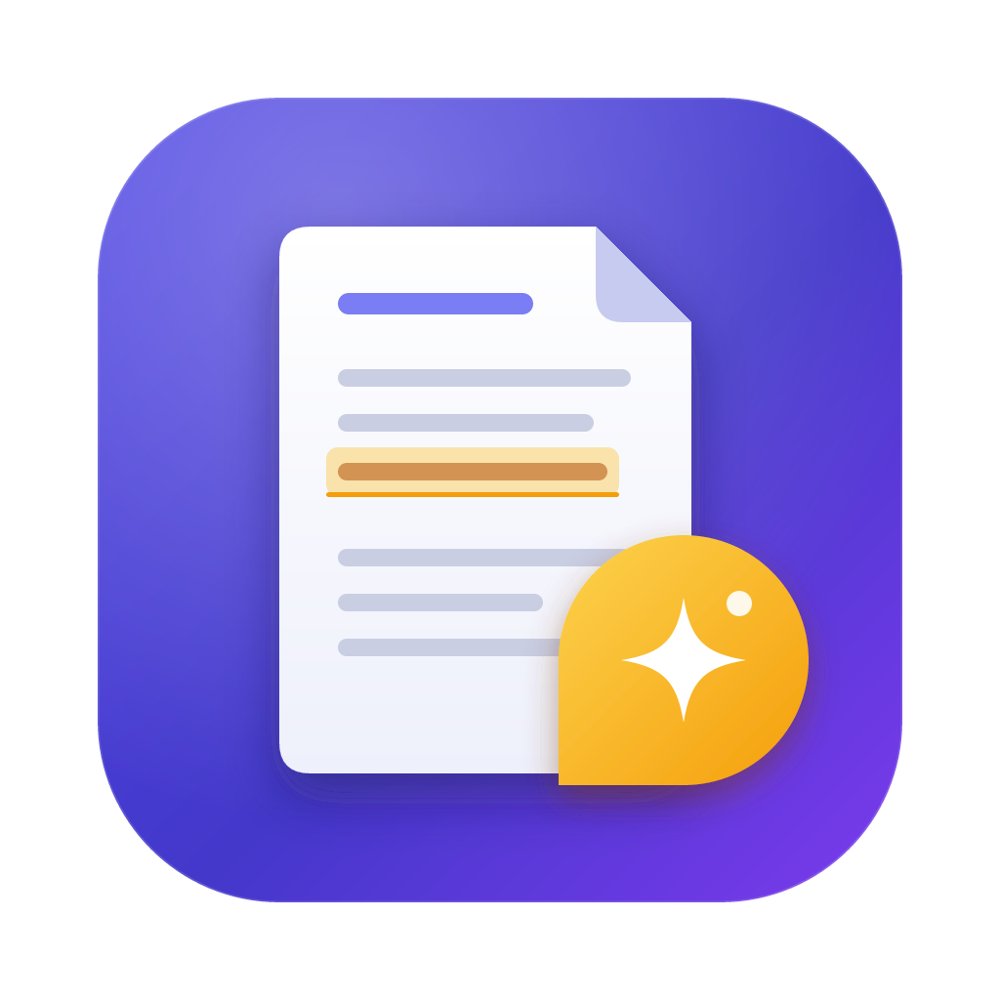
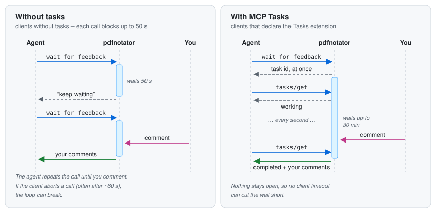

<p align="center">
  
</p>

<h1 align="center">PDFnotator</h1>

<p align="center">Pair-design Typst documents with your AI agent – point at the PDF, the agent fixes the source.</p>

<p align="center">
  <a href="../../actions/workflows/ci.yml"></a>
  <a href="../../releases/latest"></a>
  
  
  
  <a href="LICENSE"></a>
</p>


## Quick start

1. **Install** PDFnotator from the [latest release](../../releases/latest) and [Typst](https://github.com/typst/typst#installation)
   (macOS 13 or later, Windows, Linux).

   ```sh
   # macOS (Homebrew)
   brew install --cask oberbichler/tap/pdfnotator
   brew install typst

   # Windows (Scoop)
   scoop bucket add oberbichler https://github.com/oberbichler/scoop-bucket
   scoop install oberbichler/pdfnotator main/typst
   ```

2. **Connect your agent once** – click the agent chip in the title bar and copy the ready-made command, or paste
   the one for your system:

   ```sh
   # macOS
   code --add-mcp '{"name":"pdfnotator","type":"stdio","command":"/Applications/PDFnotator.app/Contents/MacOS/pdfnotator","args":["--mcp"]}'
   copilot mcp add pdfnotator -- /Applications/PDFnotator.app/Contents/MacOS/pdfnotator --mcp
   claude mcp add --scope user pdfnotator -- /Applications/PDFnotator.app/Contents/MacOS/pdfnotator --mcp

   # Windows (Scoop), Linux (.deb/.rpm): pdfnotator is on the PATH
   code --add-mcp '{"name":"pdfnotator","type":"stdio","command":"pdfnotator","args":["--mcp"]}'
   copilot mcp add pdfnotator -- pdfnotator --mcp
   claude mcp add --scope user pdfnotator -- pdfnotator --mcp
   ```

   `code` connects VS Code / Copilot, `copilot` the Copilot CLI (it doesn't read VS Code's `mcp.json`), `claude`
   Claude Code. Installed some other way (Windows installer, AppImage)? The agent chip has the command with the
   right path.

3. **Say “open in pdfnotator”** in your agent chat. That's it.

Select text and start typing – the comment box opens right away (`⇥` switches to **Replace** or **Delete**).
Press `R` and drag → screenshot comment.
Press `D` and draw on the page (`⇥`: freehand, arrow, rectangle, text note), then just start typing → sketch comment.

Annotate with a pen on an iPad or other tablet: agent menu → **Connect tablet**, scan the QR code. The tablet's
browser shows the open tabs; the pen draws, fingers scroll. Both devices must be on the same network.
The agent picks your comments up, edits the `.typ`, and the PDF updates by itself – you never press reload.
Several agents can work on several documents at once – each gets its own tab, and the status chip shows who is
listening (e.g. “GitHub Copilot CLI listening”).

| Key          | Action                          |
| ------------ | ------------------------------- |
| Select text  | Comment (`⇥`: replace · delete) |
| `V`          | Select only, no comment         |
| `R`          | Area screenshot                 |
| `D`          | Draw, then type (`⇥`: shape)    |
| `/`          | Message to the agent            |
| `⌘F`         | Find in document                |
| `⌥⌘S`        | Pages & outline sidebar         |
| `⌘1…9` `⌘W`  | Switch / close tabs             |
| Pinch / `⌘0` | Zoom / fit width                |

## How the agent waits

After each round of edits the agent calls `wait_for_feedback` and waits until you comment. How it waits depends on
what its MCP client supports:



- **With [MCP Tasks](https://github.com/modelcontextprotocol/ext-tasks)** the call returns a task id at once and
  the client polls `tasks/get` until your comments arrive (up to 30 minutes). Nothing stays open, so client
  timeouts can't cut the wait short.
- **Without tasks** each call returns after 50 s with “keep waiting” and the agent calls again. Progress
  notifications keep longer waits alive in clients that honour them.

| Client      | How it waits                                                                                             |
| ----------- | -------------------------------------------------------------------------------------------------------- |
| Copilot CLI | As a task when experimental features are on (`--experimental` or `/settings`, 1.0.114+), otherwise calls |
| Claude Code | Calls in a loop (tasks once Claude Code turns them on for your account)                                  |
| Others      | As a task if the client declares the Tasks extension, otherwise calls                                    |

Quitting or updating PDFnotator doesn't end the session: waiting agents are told to call again, and that call
restarts the app and reopens the document.

<details>
<summary>MCP tools</summary>

| Tool                                 | Purpose                                                                       |
| ------------------------------------ | ----------------------------------------------------------------------------- |
| `open_pdf(path, root?)`              | Open a `.typ` (compiled via `typst watch`) or `.pdf`                          |
| `wait_for_feedback(path)`            | Wait until the user comments; compact: quote, page, comment, small screenshot |
| `get_comments(path, ids)`            | On demand: full quote, surrounding page text, full-resolution screenshot      |
| `reply(path, message, resolved_ids)` | Answer in the viewer, mark comments done, report compile errors               |
| `viewer_status(path?)`               | Document, compile status, current page, all open documents                    |

Calls are routed by `path`, so several chats can work on different documents through one MCP server. Also
available via streamable HTTP at `http://127.0.0.1:4747/mcp`. Speaks MCP 2024-11-05 to 2026-07-28.

Environment: `PDFNOTATOR_PORT` (HTTP port, default 4747), `PDFNOTATOR_TYPST` (typst binary),
`PDFNOTATOR_REMOTE=1` (share with tablets on start and print the pairing URL), `PDFNOTATOR_REMOTE_PORT`
(default 4748).

</details>

## Develop

```sh
npm install
npm run tauri dev   # run
npm run check       # lint, types, tests (TS + Rust)
```

See [ARCHITECTURE](docs/ARCHITECTURE.md) · [CONTRIBUTING](CONTRIBUTING.md) · [CHANGELOG](CHANGELOG.md)

## License

[ISC](LICENSE) © 2026 Thomas Oberbichler
