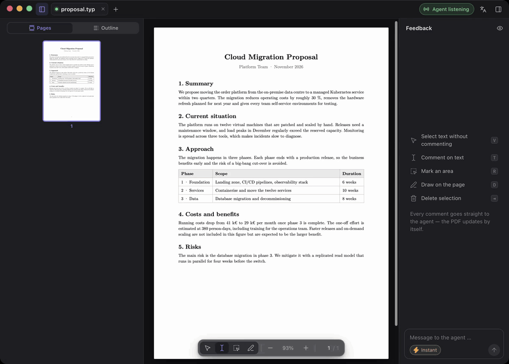

<p align="center">
  
</p>

<h1 align="center">PDFnotator</h1>

<p align="center">Pair-design Typst documents with your AI agent — point at the PDF, the agent fixes the source.</p>

<p align="center">
  <a href="../../actions/workflows/ci.yml"></a>
  <a href="../../releases/latest"></a>
  
  
  
  <a href="LICENSE"></a>
</p>



<p align="center"><sub>A real session: the scripted agent (<code>scripts/demo-agent.py</code>) edits the <code>.typ</code> file, pdfnotator recompiles and reloads. <a href="docs/demo.mp4">MP4 version</a></sub></p>

## Quick start

1. **Install** PDFnotator from the [latest release](../../releases/latest) and [Typst](https://github.com/typst/typst#installation).
2. **Connect your agent once** — click the agent chip in the title bar and copy the config, or:

   ```sh
   # VS Code / Copilot
   code --add-mcp '{"name":"pdfnotator","type":"stdio","command":"<app>","args":["--mcp"]}'
   # Copilot CLI (separate config — VS Code's mcp.json is not used)
   copilot mcp add pdfnotator -- "<app>" --mcp
   # Claude Code
   claude mcp add --scope user pdfnotator -- "<app>" --mcp
   ```

   `<app>` = e.g. `/Applications/PDFnotator.app/Contents/MacOS/pdfnotator`

3. **Say “open in pdfnotator”** in your agent chat. That's it.

Select text and start typing — the comment box opens right away (`⇥` switches to **Replace** or **Delete**).
Press `R` and drag → screenshot comment.
The agent picks your comments up, edits the `.typ`, and the PDF updates by itself — you never press reload.
Several agents can work on several documents at once — each gets its own tab.

| Key          | Action                          |
| ------------ | ------------------------------- |
| Select text  | Comment (`⇥`: replace · delete) |
| `R`          | Area screenshot                 |
| `/`          | Message to the agent            |
| `⌘F`         | Find in document                |
| `⌥⌘S`        | Pages & outline sidebar         |
| `⌘1…9` `⌘W`  | Switch / close tabs             |
| Pinch / `⌘0` | Zoom / fit width                |

<details>
<summary>MCP tools</summary>

| Tool                           | Purpose                                                                        |
| ------------------------------ | ------------------------------------------------------------------------------ |
| `open_pdf(path)`               | Open a `.typ` (compiled via `typst watch`) or `.pdf`                           |
| `wait_for_feedback()`          | Block until the user comments; compact: quote, page, comment, small screenshot |
| `get_comments(ids)`            | On demand: full quote, surrounding page text, full-resolution screenshot       |
| `reply(message, resolved_ids)` | Answer in the viewer, mark comments done, report compile errors                |
| `viewer_status()`              | Document, compile status, current page                                         |

Also available via streamable HTTP at `http://127.0.0.1:4747/mcp`.

</details>

## Develop

```sh
npm install
npm run tauri dev   # run
npm run check       # lint, types, tests (TS + Rust)
```

See [ARCHITECTURE](docs/ARCHITECTURE.md) · [CONTRIBUTING](CONTRIBUTING.md) · [CHANGELOG](CHANGELOG.md)

## License

[ISC](LICENSE) © 2026 Thomas Oberbichler
